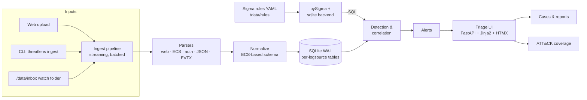
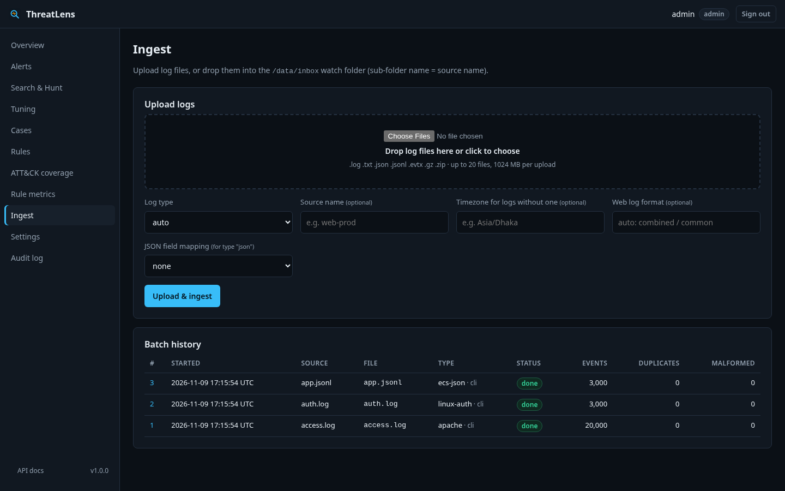

# ThreatLens

[](https://github.com/Tamimsharif83/threatlens/actions/workflows/ci.yml)
[](LICENSE)
[](https://github.com/Tamimsharif83/threatlens/pkgs/container/threatlens)

**ThreatLens is a lightweight, self-hosted detection and investigation platform
(a "mini-SIEM") for security analysts, students and small teams.** Point it at
your web server, application, Linux and Windows logs; it normalizes them,
detects threats with standard **Sigma** rules (including Sigma v2 correlation
rules), and gives you a complete analyst workflow: alert triage → investigation
→ case timeline → MITRE ATT&CK coverage → incident report. It runs on an 8 GB
laptop with one `docker run`, fully offline.

> **Status: early development (v0.6.0, Phase 5 of 8).** Ingestion, Sigma
> detection and correlation, triage, hunting, tuning, cases and incident reports
> work. ATT&CK coverage and rule metrics arrive next — see the [roadmap](#roadmap).


## Quickstart

```bash
docker run -d --name threatlens -p 127.0.0.1:8080:8080 \
  -v threatlens-data:/data ghcr.io/tamimsharif83/threatlens:latest

docker logs threatlens   # shows the generated admin password (once)
```

Open <http://127.0.0.1:8080> and sign in as `admin` (you will be asked to choose
your own password).

**Try it with sample data** (synthetic, generated from a fixed seed):

```bash
docker exec threatlens sh -c 'threatlens synth --kind web --lines 20000 -o /data/tmp/access.log &&
  threatlens synth --kind auth --lines 3000 -o /data/tmp/auth.log &&
  threatlens synth --kind ecs --lines 3000 -o /data/tmp/app.jsonl &&
  threatlens ingest /data/tmp/access.log /data/tmp/auth.log /data/tmp/app.jsonl'
```

**Your own logs:** upload them on the *Ingest* page, or mount a folder as the
watch folder (read-only is fine) and new lines are picked up within seconds:

```bash
docker run -d --name threatlens -p 127.0.0.1:8080:8080 -v threatlens-data:/data \
  -v /var/log/nginx:/data/inbox/web-prod:ro ghcr.io/tamimsharif83/threatlens:latest
```

The port is bound to `127.0.0.1` on purpose: ThreatLens is only reachable from
your own machine. To expose it, put a TLS reverse proxy in front (see
[Configuration](#configuration)). Port 8080 taken? See
[Changing the port](#changing-the-port).

**Hardened run** (recommended; the image supports it out of the box):

```bash
docker run -d --name threatlens -p 127.0.0.1:8080:8080 \
  -v threatlens-data:/data \
  --read-only --cap-drop ALL --security-opt no-new-privileges \
  ghcr.io/tamimsharif83/threatlens:latest
```

**Build from source:**

```bash
git clone https://github.com/Tamimsharif83/threatlens.git && cd threatlens
cp .env.example .env          # optional: change the port or set an admin password
docker compose up -d
docker compose logs threatlens | grep -A3 "first run"
```

Lost the admin password? `docker exec -it threatlens threatlens user reset-password admin`

Useful CLI commands (inside the container: `docker exec threatlens threatlens …`):
`ingest`, `rules lint|test|list|hunt|import-sigmahq`, `db stats|purge|compact`, `synth`,
`user reset-password`.

### Changing the port

ThreatLens listens on port 8080 inside the container. If 8080 is already in use
on your machine (`Bind for 0.0.0.0:8080 failed: port is already allocated` means
*another* container or program holds it), pick a different host port. ThreatLens
stays bound to `127.0.0.1` either way.

- **Docker Compose:** set `TL_HOST_PORT` in `.env`, e.g. `TL_HOST_PORT=8090`,
  then `docker compose up -d` and open <http://127.0.0.1:8090>.
  For a one-off: `TL_HOST_PORT=8090 docker compose up -d`.
- **docker run:** change the first number of `-p`, keeping the `127.0.0.1:` prefix:
  `-p 127.0.0.1:8090:8080`.

To see what holds a port: `docker ps --format '{{.Names}}\t{{.Ports}}' | grep 8080`
(or `ss -ltnp | grep 8080` for non-Docker programs).

Never drop the `127.0.0.1:` prefix to "fix" a conflict: that publishes ThreatLens
on every network interface. A test (`tests/test_deployment.py`) fails if the
Compose file or the documented commands stop binding to localhost.

## Features

| Area | What you get | Status |
|---|---|---|
| Platform | One container, offline, < 100 MB idle RAM, login with argon2id, roles, audit log | ✅ Phase 0 |
| Ingestion | Apache/Nginx (combined, common, custom formats), ECS JSON Lines, Linux auth, generic JSON + field mapping, `.gz`/`.zip`; drag & drop upload, CLI, watch folder with rotation handling; dedup; retention; ingest reports | ✅ Phase 1 |
| Users | Admin creates analysts in Settings (one-time password, forced change); no passwords in env vars except the first admin | ✅ Phase 1 |
| Detection | Sigma rules via pySigma, run on every batch + retro-hunt, alert grouping/throttling, rule tests & lint, compiled SQL shown per rule, SigmaHQ import | ✅ Phase 2 |
| Triage | Alert queue (statuses, verdicts, assignee, notes, bulk actions, keyboard), "why it fired" with highlighted fields, entity pivots ±1 h, field search, read-only SQL hunt console with saved hunts and safe CSV export, Sigma filters + suppressions (reason, author, expiry, hit counts), audit log | ✅ Phase 3 |
| Correlation | Sigma v2 `event_count`, `value_count`, `value_sum`, `value_avg`, `temporal`, `temporal_ordered`, across log sources with aliases; one alert per group, linked to child alerts; `generate` honoured | ✅ Phase 4 |
| Cases & reports | Cases from alerts (bulk or single), merged event-time timeline with annotations, ATT&CK findings, IOCs (auto-extracted + manual, CSV/JSON), notes, severity/status/owner; incident report (summary, scope, timeline, findings, IOCs, impact, root cause, recommendations, appendix) as Markdown and print-ready self-contained HTML | ✅ Phase 5 |
| Coverage & metrics | ATT&CK v20.0 matrix (bundled, offline) with levels for rules / tested / fired, sub-techniques roll up, stale-tag warnings, Navigator layer export; per-rule events, alerts, verdicts, precision and noisiest rules — see [docs/attack-coverage.md](docs/attack-coverage.md) | ✅ Phase 6 |
| Windows | `.evtx` upload/watch/CLI (also in `.zip`/`.gz`, or `evtx_dump` JSON Lines): Security, Sysmon, PowerShell, System and other channels; Sigma field names + ECS aliases; rules compiled with the official pySigma Windows/Sysmon pipelines (SigmaHQ Windows rules work as written); `.evtx` rule-test fixtures | ✅ Phase 7 |

## Architecture



More detail: [docs/architecture.md](docs/architecture.md) and the
[Architecture Decision Records](docs/adr/).

## Supported log formats

| Type | Examples | Details |
|---|---|---|
| Web access logs | Apache/Nginx combined, common, vhost, or your own `LogFormat` / `log_format` | [log-formats.md](docs/log-formats.md#web-server-access-logs-apache-nginx) |
| ECS JSON Lines | application events with Elastic Common Schema names | [log-formats.md](docs/log-formats.md#ecs-json-lines-ecs-json) |
| Linux auth | `auth.log`, `secure`: sshd, sudo, su, PAM, useradd/usermod, cron | [log-formats.md](docs/log-formats.md#linux-auth-linux-auth) |
| Any JSON Lines | with an optional [field mapping](examples/mappings/) | [log-formats.md](docs/log-formats.md#generic-json-lines-json-and-field-mappings) |
| Windows EVTX | Security, Sysmon, PowerShell, System (any channel); `.evtx`, inside `.zip`/`.gz`, or `evtx_dump` JSON Lines | [log-formats.md](docs/log-formats.md#windows-event-logs-evtx) |

Plain files, `.evtx`, `.gz` and `.zip`. The format is auto-detected or chosen explicitly.
How events are stored: [docs/schema.md](docs/schema.md).



## Writing rules

ThreatLens runs standard [Sigma](https://sigmahq.io/) rules. Put yours in
`/data/rules` (mount a folder there), with optional test fixtures in
`/data/rules/tests/<rule-id>/tp.log` (must fire) and `tn.log` (must not), then
click **Rules → Reload**. ThreatLens ships five `[Example]` rule files only (one of
them pairs a base rule with a brute-force correlation); it is a platform for
**your** detection engineering, not a rule pack.

```bash
threatlens rules lint      # valid Sigma, unique ids, required metadata, ATT&CK tags
threatlens rules test      # true/false-positive fixtures, also run on every reload
threatlens rules hunt <id> # retro-hunt over all stored events
```

Guides: [triage workflow](docs/triage-workflow.md) · [writing rules](docs/writing-rules.md) ·
[correlation rules](docs/correlation-rules.md) ·
[how the engine works](docs/adr/0005-detection-engine.md).

## Configuration

All settings are environment variables with the `TL_` prefix.

| Variable | Default | Meaning |
|---|---|---|
| `TL_HOST_PORT` | `8080` | **Compose only:** host port published on `127.0.0.1` (set in `.env`; see [Changing the port](#changing-the-port)) |
| `TL_PORT` | `8080` | HTTP port inside the container (normally leave as is; change `TL_HOST_PORT` instead) |
| `TL_HOST` | `0.0.0.0` in the image, `127.0.0.1` otherwise | Bind address |
| `TL_DATA_DIR` | `/data` in the image | Where all state is kept |
| `TL_ADMIN_USERNAME` | `admin` | First-run admin username |
| `TL_ADMIN_PASSWORD` | *(unset)* | First-run admin password (≥ 12 chars). Unset: a random one is printed once to the log. Only used when no users exist. |
| `TL_RETENTION_DAYS` | `30` | Data ingested more than this many days ago is purged (changeable in Settings) |
| `TL_MAX_UPLOAD_MB` | `1024` | Maximum size of one upload request |
| `TL_MAX_DECOMPRESSED_MB` | `10240` | Maximum data expanded from one `.gz`/`.zip` (bomb protection) |
| `TL_STORE_RAW` | `false` | Also keep each raw log line, zstd-compressed with a per-batch dictionary |
| `TL_DELETE_UPLOADS` | `true` | Delete uploaded files after ingest (`false` keeps them in `/data/uploads/kept`) |
| `TL_WATCH_ENABLED` | `true` | Ingest files placed in `/data/inbox` |
| `TL_WATCH_INTERVAL_SECONDS` | `5` | How often the watch folder is checked |
| `TL_ALERT_THROTTLE_MINUTES` | `60` | Same rule + same entity (source IP, else user, else host) within this window of event time = one alert |
| `TL_RULES_DIR` | `/data/rules` | Your Sigma rules (and Sigma filters) |
| `TL_HUNT_ROW_LIMIT` | `1000` | Maximum rows returned by the hunt console |
| `TL_HUNT_TIMEOUT_SECONDS` | `10` | Hunt console query time limit |
| `TL_BUILTIN_RULES` | `true` | Load the bundled `[Example]` rules |
| `TL_DEFAULT_TIMEZONE` | `UTC` | Timezone for log timestamps without one (changeable in Settings) |
| `TL_LOG_LEVEL` | `INFO` | `DEBUG`, `INFO`, `WARNING`, `ERROR` |
| `TL_SESSION_HOURS` | `12` | Session lifetime |
| `TL_COOKIE_SECURE` | `auto` | `auto` (Secure when the request is HTTPS), `always`, `never` |
| `TL_FORWARDED_ALLOW_IPS` | *(empty)* | Reverse-proxy IPs trusted for `X-Forwarded-*` headers (needed for `auto` to detect HTTPS behind a proxy) |
| `TL_LOGIN_MAX_FAILURES` | `5` | Failed logins per IP / per username before a lockout |
| `TL_LOGIN_WINDOW_MINUTES` | `15` | Lockout sliding window |

Local-only settings (extra mounts, your timezone) go in a gitignored
`docker-compose.override.yml`; start from
[`docker-compose.override.yml.example`](docker-compose.override.yml.example).

## Development

```bash
uv sync                      # Python 3.13 venv with dev tools
uv run pytest                # tests + coverage
uv run ruff check . && uv run ruff format --check . && uv run mypy
uv run threatlens serve      # http://127.0.0.1:8080, data in ./data
pre-commit install           # ruff + gitleaks on every commit
```

See [CONTRIBUTING.md](CONTRIBUTING.md).

## Roadmap

| Phase | Scope | Status |
|---|---|---|
| 0 | Plan & scaffold: ADRs, CI, Docker, login, empty dashboard | ✅ done |
| 1 | Ingestion & storage | ✅ done |
| 2 | Detection (Sigma) | ✅ done |
| 3 | Triage | ✅ done |
| 4 | Correlation | ✅ done |
| 5 | Cases & reports | ✅ done |
| 6 | ATT&CK coverage & metrics | ✅ done |
| 7 | Windows EVTX | ✅ done |
| 8 | Hardening & v1.0.0 release | next |

Non-goals for v1: endpoint agents, clustering, machine learning, cloud
dependencies, replacing an enterprise SIEM.

## Security

ThreatLens renders attacker-controlled data and is built with that in mind (strict
CSP, autoescaping everywhere, CSRF protection, argon2id, a hardened container).
See [docs/adr/0003-security-baseline.md](docs/adr/0003-security-baseline.md).
Report vulnerabilities privately as described in [SECURITY.md](SECURITY.md).

## License

[Apache-2.0](LICENSE). Bundled third-party assets keep their own licenses — see
[`src/threatlens/web/static/vendor/VENDORED.md`](src/threatlens/web/static/vendor/VENDORED.md).

MITRE ATT&CK® is a registered trademark of The MITRE Corporation. ThreatLens
bundles a list of ATT&CK technique and tactic names, used under the
[ATT&CK terms of use](https://attack.mitre.org/resources/legal-and-branding/terms-of-use/)
(see [`src/threatlens/attack/data/README.md`](src/threatlens/attack/data/README.md)).
