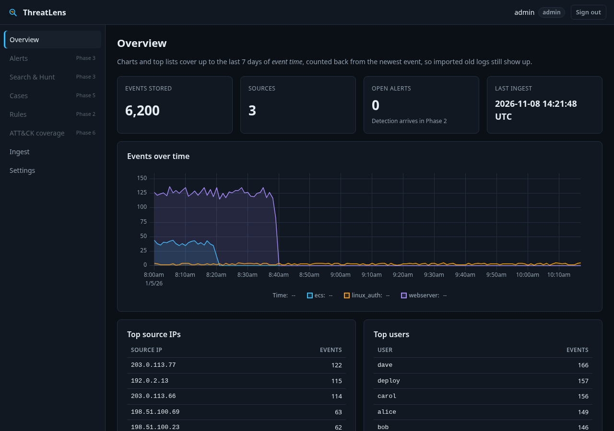
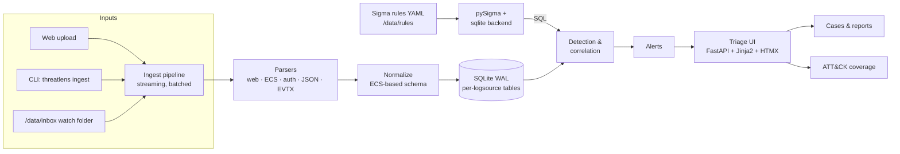

# ThreatLens

[](https://github.com/Tamimsharif83/threatlens/actions/workflows/ci.yml)
[](LICENSE)
[](https://github.com/Tamimsharif83/threatlens/pkgs/container/threatlens)

**ThreatLens is a lightweight, self-hosted detection and investigation platform
(a "mini-SIEM") for security analysts, students and small teams.** Point it at
your web server, application, Linux and Windows logs; it normalizes them,
detects threats with standard **Sigma** rules (including Sigma v2 correlation
rules), and gives you a complete analyst workflow: alert triage → investigation
→ case timeline → MITRE ATT&CK coverage → incident report. It runs on an 8 GB
laptop with one `docker run`, fully offline.

> **Status: early development (v0.1.0, Phase 0 of 8).** The platform skeleton,
> authentication and container are in place. Ingestion arrives next — see the
> [roadmap](#roadmap).



## Quickstart

```bash
docker run -d --name threatlens -p 127.0.0.1:8080:8080 \
  -v threatlens-data:/data ghcr.io/tamimsharif83/threatlens:latest

docker logs threatlens   # shows the generated admin password (once)
```

Open <http://127.0.0.1:8080> and sign in as `admin`.

The port is bound to `127.0.0.1` on purpose: ThreatLens is only reachable from
your own machine. To expose it, put a TLS reverse proxy in front (see
[Configuration](#configuration)). Port 8080 taken? See
[Changing the port](#changing-the-port).

**Hardened run** (recommended; the image supports it out of the box):

```bash
docker run -d --name threatlens -p 127.0.0.1:8080:8080 \
  -v threatlens-data:/data \
  --read-only --cap-drop ALL --security-opt no-new-privileges \
  ghcr.io/tamimsharif83/threatlens:latest
```

**Build from source:**

```bash
git clone https://github.com/Tamimsharif83/threatlens.git && cd threatlens
cp .env.example .env          # optional: change the port or set an admin password
docker compose up -d
docker compose logs threatlens | grep -A3 "first run"
```

Lost the admin password? `docker exec -it threatlens threatlens user reset-password admin`

### Changing the port

ThreatLens listens on port 8080 inside the container. If 8080 is already in use
on your machine (`Bind for 0.0.0.0:8080 failed: port is already allocated` means
*another* container or program holds it), pick a different host port. ThreatLens
stays bound to `127.0.0.1` either way.

- **Docker Compose:** set `TL_HOST_PORT` in `.env`, e.g. `TL_HOST_PORT=8090`,
  then `docker compose up -d` and open <http://127.0.0.1:8090>.
  For a one-off: `TL_HOST_PORT=8090 docker compose up -d`.
- **docker run:** change the first number of `-p`, keeping the `127.0.0.1:` prefix:
  `-p 127.0.0.1:8090:8080`.

To see what holds a port: `docker ps --format '{{.Names}}\t{{.Ports}}' | grep 8080`
(or `ss -ltnp | grep 8080` for non-Docker programs).

Never drop the `127.0.0.1:` prefix to "fix" a conflict: that publishes ThreatLens
on every network interface. A test (`tests/test_deployment.py`) fails if the
Compose file or the documented commands stop binding to localhost.

## Features

| Area | What you get | Status |
|---|---|---|
| Platform | One container, offline, < 100 MB idle RAM, login with argon2id, roles, audit log | ✅ Phase 0 |
| Ingestion | Apache/Nginx, ECS JSON Lines, Linux auth, generic JSON + field mapping, `.gz`/`.zip`; upload, CLI, watch folder | Phase 1 |
| Detection | Sigma rules via pySigma, run on every batch + retro-hunt, alert grouping/throttling, rule tests & lint | Phase 2 |
| Triage | Alert queue, "why it fired", entity pivots, search, read-only SQL hunt console, suppressions | Phase 3 |
| Correlation | Sigma v2 `event_count`, `value_count`, `temporal`, `temporal_ordered` | Phase 4 |
| Cases & reports | Case timeline, IOCs (CSV/JSON), Markdown/HTML incident report | Phase 5 |
| Coverage | ATT&CK matrix, Navigator layer export, per-rule precision metrics | Phase 6 |
| Windows | EVTX: Security, Sysmon, PowerShell | Phase 7 |

## Architecture



More detail: [docs/architecture.md](docs/architecture.md) and the
[Architecture Decision Records](docs/adr/).

## Supported log formats

Planned for v1 (Phase 1 and Phase 7): Apache/Nginx combined and common, ECS JSON
Lines, Linux `auth.log`/`secure`, Windows EVTX (Security, Sysmon,
PowerShell/Operational, System), and generic JSON Lines with a field-mapping YAML.
Details will be in `docs/log-formats.md`.

## Writing rules

ThreatLens uses standard [Sigma](https://sigmahq.io/) rules. You will put your
own rules in `/data/rules`. A guide (`docs/writing-rules.md` and
`docs/correlation-rules.md`) arrives with Phase 2. ThreatLens ships only a
handful of example rules; it is a platform for **your** detection engineering,
not a rule pack.

## Configuration

All settings are environment variables with the `TL_` prefix.

| Variable | Default | Meaning |
|---|---|---|
| `TL_HOST_PORT` | `8080` | **Compose only:** host port published on `127.0.0.1` (set in `.env`; see [Changing the port](#changing-the-port)) |
| `TL_PORT` | `8080` | HTTP port inside the container (normally leave as is; change `TL_HOST_PORT` instead) |
| `TL_HOST` | `0.0.0.0` in the image, `127.0.0.1` otherwise | Bind address |
| `TL_DATA_DIR` | `/data` in the image | Where all state is kept |
| `TL_ADMIN_USERNAME` | `admin` | First-run admin username |
| `TL_ADMIN_PASSWORD` | *(unset)* | First-run admin password (≥ 12 chars). Unset: a random one is printed once to the log. Only used when no users exist. |
| `TL_RETENTION_DAYS` | `30` | Events older than this are purged (Phase 1) |
| `TL_MAX_UPLOAD_MB` | `1024` | Maximum upload size (Phase 1) |
| `TL_STORE_RAW` | `false` | Also keep the raw log line, zstd-compressed (Phase 1) |
| `TL_DELETE_UPLOADS` | `true` | Delete uploaded files after a successful ingest (Phase 1) |
| `TL_ALERT_THROTTLE_MINUTES` | `60` | Same rule + same entity within this window = one alert (Phase 2) |
| `TL_DEFAULT_TIMEZONE` | `UTC` | Timezone for logs whose timestamps have none (Phase 1) |
| `TL_LOG_LEVEL` | `INFO` | `DEBUG`, `INFO`, `WARNING`, `ERROR` |
| `TL_SESSION_HOURS` | `12` | Session lifetime |
| `TL_COOKIE_SECURE` | `auto` | `auto` (Secure when the request is HTTPS), `always`, `never` |
| `TL_FORWARDED_ALLOW_IPS` | *(empty)* | Reverse-proxy IPs trusted for `X-Forwarded-*` headers (needed for `auto` to detect HTTPS behind a proxy) |
| `TL_LOGIN_MAX_FAILURES` | `5` | Failed logins per IP / per username before a lockout |
| `TL_LOGIN_WINDOW_MINUTES` | `15` | Lockout sliding window |

Local-only settings (extra mounts, your timezone) go in a gitignored
`docker-compose.override.yml`; start from
[`docker-compose.override.yml.example`](docker-compose.override.yml.example).

## Development

```bash
uv sync                      # Python 3.13 venv with dev tools
uv run pytest                # tests + coverage
uv run ruff check . && uv run ruff format --check . && uv run mypy
uv run threatlens serve      # http://127.0.0.1:8080, data in ./data
pre-commit install           # ruff + gitleaks on every commit
```

See [CONTRIBUTING.md](CONTRIBUTING.md).

## Roadmap

| Phase | Scope | Status |
|---|---|---|
| 0 | Plan & scaffold: ADRs, CI, Docker, login, empty dashboard | ✅ done |
| 1 | Ingestion & storage | next |
| 2 | Detection (Sigma) | |
| 3 | Triage | |
| 4 | Correlation | |
| 5 | Cases & reports | |
| 6 | ATT&CK coverage & metrics | |
| 7 | Windows EVTX | |
| 8 | Hardening & v1.0.0 release | |

Non-goals for v1: endpoint agents, clustering, machine learning, cloud
dependencies, replacing an enterprise SIEM.

## Security

ThreatLens renders attacker-controlled data and is built with that in mind (strict
CSP, autoescaping everywhere, CSRF protection, argon2id, a hardened container).
See [docs/adr/0003-security-baseline.md](docs/adr/0003-security-baseline.md).
Report vulnerabilities privately as described in [SECURITY.md](SECURITY.md).

## License

[Apache-2.0](LICENSE). Bundled third-party assets keep their own licenses — see
[`src/threatlens/web/static/vendor/VENDORED.md`](src/threatlens/web/static/vendor/VENDORED.md).
