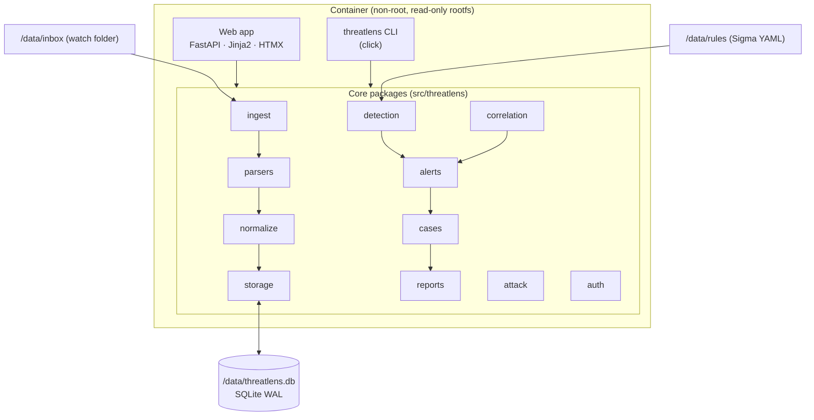

# Architecture

ThreatLens is a single Python process in a single container. All state lives in
one SQLite database under `/data`.

## Packages

| Package | Responsibility | Phase |
|---|---|---|
| `config` | `TL_*` settings, validated at startup | 0 |
| `logging_setup` | ThreatLens' own logs as JSON lines | 0 |
| `storage` | SQLite connections, pragmas, numbered SQL migrations | 0 |
| `auth` | argon2id passwords, users and roles, server-side sessions, login throttle | 0 |
| `audit` | append-only audit log of analyst and system actions | 0 |
| `web` | FastAPI app, security headers, CSRF, templates, static assets | 0 |
| `cli` | `threatlens` command (serve, healthcheck, user, later ingest/rules/db) | 0 |
| `ingest` | safe readers (archives, limits), streaming pipeline, upload worker, watch folder | 1 |
| `parsers` | web access, Linux auth, ECS JSON, generic JSON + mappings, Windows event records; format detection | 1, 7 |
| `normalize` | event model, Sigma log sources → tables, value conversion | 1 |
| `storage` (events, maintenance) | per-log-source event tables, field catalog, retention, stats | 1 |
| `services` | background threads: ingest worker, inbox watcher, maintenance | 1 |
| `stats` | overview aggregates | 1 |
| `detection` | load/validate/lint Sigma rules, route to tables, compile with pySigma, run per batch and retro-hunt, rule tests, SigmaHQ import | 2 |
| `alerts` | grouping, throttling, event references; triage (status, verdict, assignee, notes, history); suppressions | 2–3 |
| `search` | field-filter search; read-only SQL hunt console sandbox | 3 |
| `export` | formula-safe CSV | 3 |
| `correlation` | compile correlations with their referenced rules; incremental runs via window views; merge windows into alerts; child links | 4 |
| `cases` | cases, alert links, notes, annotations, merged timeline, ATT&CK findings, IOC extraction | 5 |
| `reports` | Markdown and self-contained HTML incident reports | 5 |
| `attack` | technique catalog, coverage matrix, Navigator export | 6 |

## Request flow (web)

1. `SecurityHeadersMiddleware` wraps every response (CSP, nosniff, frame denial,
   `no-store`).
2. Page routes depend on `require_session`, which loads the session from the
   cookie (SHA-256 lookup), and for POST/PUT/PATCH/DELETE checks `Origin` /
   `Sec-Fetch-Site` and the CSRF token.
3. Unauthenticated page requests redirect to `/login?next=…` (HTMX requests get
   an `HX-Redirect` header); API requests get `401` JSON.
4. Templates render with autoescaping; JS is only loaded from `/static`.

## Data layout

See [ADR-0002](adr/0002-storage-engine-and-event-layout.md),
[ADR-0004](adr/0004-ingestion-pipeline.md) and [schema.md](schema.md).

| Table | Purpose |
|---|---|
| `users` | accounts, argon2id hashes, role, disabled flag, must-change-password |
| `sessions` | SHA-256 of session tokens, CSRF token, expiry |
| `audit_log` | who did what, when, from where |
| `app_settings` | settings changed in the UI (retention, default timezone) |
| `sources`, `ingest_batches`, `ingest_batch_tables`, `raw_dicts`, `watch_files` | ingestion bookkeeping |
| `event_tables`, `event_fields`, `ev_*` | events and their catalog (see [schema.md](schema.md)) |

Schema changes are numbered SQL files in `src/threatlens/storage/migrations/`,
applied in order at startup and tracked with `PRAGMA user_version`. Index changes that SQL alone cannot express per table (v1.0: pivot indexes as `(field, tl_ts)`) are applied by `upgrade_pivot_indexes` right after the migrations.
