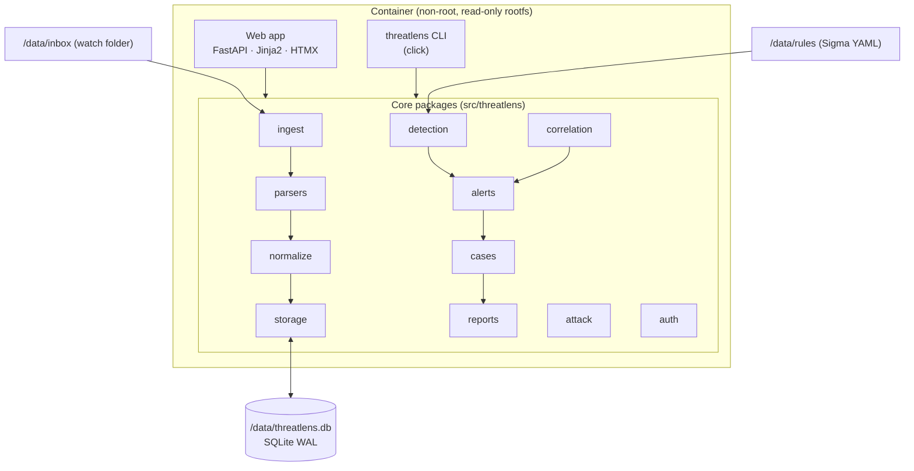

# Architecture

ThreatLens is a single Python process in a single container. All state lives in
one SQLite database under `/data`.

## Packages

| Package | Responsibility | Phase |
|---|---|---|
| `config` | `TL_*` settings, validated at startup | 0 |
| `logging_setup` | ThreatLens' own logs as JSON lines | 0 |
| `storage` | SQLite connections, pragmas, numbered SQL migrations | 0 |
| `auth` | argon2id passwords, users and roles, server-side sessions, login throttle | 0 |
| `audit` | append-only audit log of analyst and system actions | 0 |
| `web` | FastAPI app, security headers, CSRF, templates, static assets | 0 |
| `cli` | `threatlens` command (serve, healthcheck, user, later ingest/rules/db) | 0 |
| `ingest` | upload, CLI and watch-folder sources; batching; dedup | 1 |
| `parsers` | one parser per input format, streaming | 1 |
| `normalize` | map parsed records to the ECS-based schema | 1 |
| `detection` | load/validate Sigma rules, compile with pySigma, run per batch and retro-hunt | 2 |
| `alerts` | grouping, throttling, triage state | 2–3 |
| `correlation` | Sigma v2 correlation rules, parent/child alert links | 4 |
| `cases`, `reports` | cases, timelines, IOCs, Markdown/HTML export | 5 |
| `attack` | technique catalog, coverage matrix, Navigator export | 6 |

## Request flow (web)

1. `SecurityHeadersMiddleware` wraps every response (CSP, nosniff, frame denial,
   `no-store`).
2. Page routes depend on `require_session`, which loads the session from the
   cookie (SHA-256 lookup), and for POST/PUT/PATCH/DELETE checks `Origin` /
   `Sec-Fetch-Site` and the CSRF token.
3. Unauthenticated page requests redirect to `/login?next=…` (HTMX requests get
   an `HX-Redirect` header); API requests get `401` JSON.
4. Templates render with autoescaping; JS is only loaded from `/static`.

## Data layout

See [ADR-0002](adr/0002-storage-engine-and-event-layout.md). Phase 0 creates:

| Table | Purpose |
|---|---|
| `users` | accounts, argon2id hashes, role, disabled flag |
| `sessions` | SHA-256 of session tokens, CSRF token, expiry |
| `audit_log` | who did what, when, from where |

Schema changes are numbered SQL files in `src/threatlens/storage/migrations/`,
applied in order at startup and tracked with `PRAGMA user_version`.
