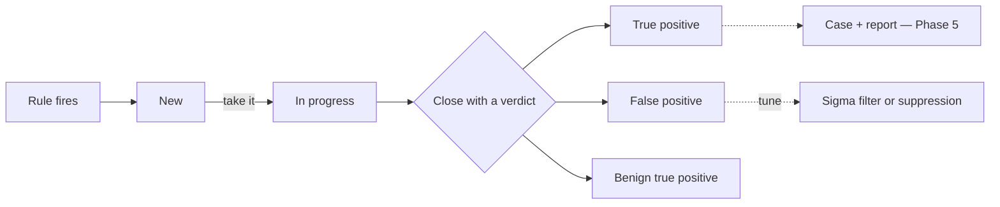

# Triage workflow

How an alert goes from "fired" to "closed" in ThreatLens.



## 1. Work the queue (Alerts)

- The default view shows **open** alerts (new + in progress). Filter by level,
  rule, assignee (`me`, `unassigned`) or any entity text (IP, user, host).
- Sort by severity to start with critical and high alerts.
- **Bulk actions:** tick alerts (or press `x`), then set a status or assign them.
- **Keyboard:** `j`/`k` move, `x` select, `o` or `Enter` opens, `/` searches, `?` help.

An alert groups every match of one rule for one primary entity (source IP, else
user, else host) within the throttle window, so 400 failed logins from one
address are one alert with a count of 400.

## 2. Understand it (alert page)

- **Why it fired:** the rule's description and YAML; the fields the rule tests
  are **highlighted** in every matched event.
- **Matched events:** every event, with all its fields and the raw line if
  `TL_STORE_RAW=true`. Events deleted by retention are marked "purged".
- **Pivots:** for each entity, *All … events ±1 h* opens a search for everything
  that entity did around the alert, *Other alerts* finds related alerts, and
  *Suppress…* prefills a suppression.
- **Notes and history:** notes are free text. The history lists every status,
  assignment and note change, with who made it and when.

## 3. Investigate further (Search & Hunt)

- **Search:** pick an event table, a UTC time range and up to four
  `field operator value` conditions. Each result links to the full event.
- **Hunt console:** read-only SQL over the event tables (`ev_webserver`,
  `ev_linux_auth`, `ev_ecs` …) and over alerts, rules and ingest history.
  Field names are columns: quote them, as in `"source.ip"`. Runs are
  time- and row-limited. Users and sessions are not readable.
  Save useful hunts with a description and an ATT&CK tag; export results as CSV
  (formula-safe).

```sql
-- Who probed many different paths and got mostly errors?
SELECT "source.ip", count(*) AS requests, count(DISTINCT "url.path") AS paths,
       round(avg("http.response.status_code" >= 400) * 100) AS pct_errors
FROM ev_webserver
GROUP BY 1 HAVING paths > 20
ORDER BY pct_errors DESC, requests DESC
LIMIT 20;
```

## 4. Close with a verdict

Closing requires a resolution:

| Resolution | Meaning | Usually followed by |
|---|---|---|
| True positive | malicious activity, correctly detected | a case and report (Phase 5) |
| False positive | the rule fired on something that is not what it looks for | tuning the rule |
| Benign true positive | the rule was right, but the activity is authorised (your own scanner, a pentest) | a suppression with an expiry |

These verdicts feed the per-rule precision metric (Phase 6):
precision = TP / (TP + FP).

## 5. Tune (Tuning page)

- **Fix the rule** when it is simply wrong (false positives).
- **Sigma filter** for stable, documented exceptions that belong with the rules
  as code (e.g. "our vulnerability scanner at 203.0.113.77 is allowed to trigger
  the scanner rule"):

  ```yaml
  title: Internal vulnerability scanner
  id: 4d7f1c8a-0b2e-4a51-9f3c-1e2d3c4b5a69
  logsource:
    category: webserver
  filter:
    rules:
      - 52aae84e-25a3-483f-b8d5-649cda5d9c73   # rule id or name, or "any"
    selection:
      c-ip: 203.0.113.77
    condition: not selection
  ```
- **Suppression** for quick, possibly temporary exceptions from the UI: field,
  value, optional rule, a **required reason**, optional **expiry**. Each entry
  counts how often it hid a match. Review entries with many hits or no recent hits.

Everything above is in the audit log (**Audit log**, admins).
